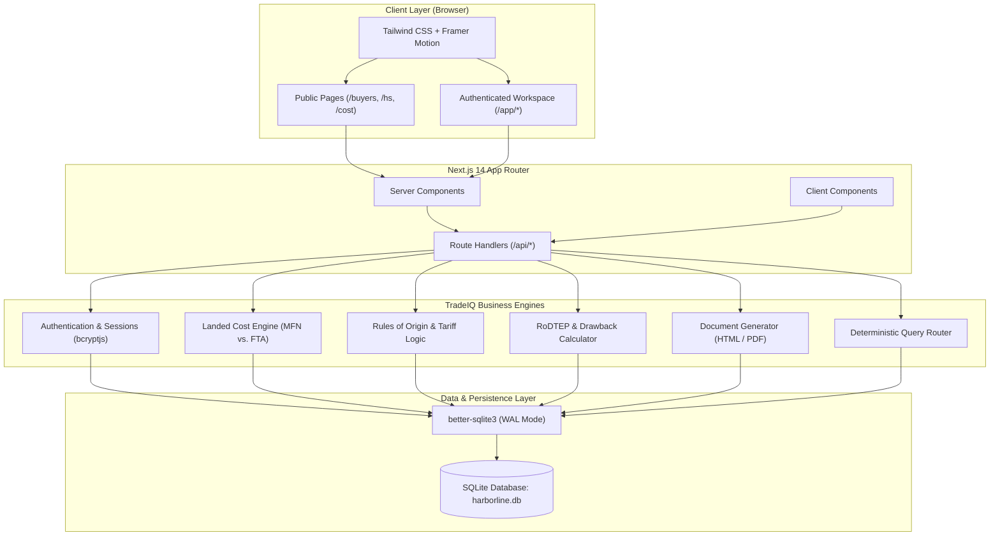

# TradeIQ
### AI-Driven Global Trade Risk and Import-Export Intelligence System

TradeIQ is an academic, India-first international trade intelligence and risk assessment platform designed to help small and medium-sized enterprises (SMEs), merchant exporters, and trade professionals navigate global commerce. Developed as a major university engineering project, TradeIQ streamlines the entire trade lifecycle—from discovering overseas counterparties and evaluating cross-border trade risks to classifying Harmonized System (HS) codes, calculating landed costs, navigating Free Trade Agreements (FTAs), claiming government export incentives, and generating standardized commercial trade documents.

---

## Project Overview

For emerging exporters and small manufacturing enterprises, breaking into international markets presents formidable barriers. Finding genuine overseas buyers often requires expensive corporate subscriptions or risky cold outreach. Understanding multi-component import tariffs, freight build-ups, rules of origin under trade pacts, and customs documentation requirements is traditionally fragmented across disconnected government portals.

TradeIQ unifies these capabilities into an integrated, interactive digital platform. Indian exporters and importers can search for overseas buyers by commodity or HS code, inspect verified counterparty profiles, evaluate market risks and tariff differentials, simulate landed cost scenarios, identify applicable export incentives (such as RoDTEP, RoSCTL, and Duty Drawback), and generate export-compliant documentation within a unified workspace.

---

## Problem Statement

International trade operations pose substantial challenges for independent exporters and traders:
- **Difficulty Finding Overseas Buyers**: Discovering verified importers without relying on opaque middlemen or expensive proprietary databases.
- **Limited Counterparty Transparency**: Lack of visibility into buyer operational profiles, verification history, order volume bands, and acceptable Incoterms.
- **Complex HS Code Classification**: Navigating 8-digit ITC-HS schedules, understanding applicable Goods and Services Tax (GST), and discerning Basic Customs Duty (BCD) rates.
- **Opaque Landed Cost Computation**: Factoring multi-stage freight charges, insurance, port handling, ad-valorem tariffs, and social welfare surcharges into delivered pricing.
- **Underutilized Free Trade Agreements**: Missing preferential zero-duty or reduced-duty concessions under bilateral pacts (e.g., India–UAE CEPA, India–Australia ECTA, ASEAN–India ATIGA) due to complex Rules of Origin (RoO).
- **Unclaimed Government Incentives**: Overlooking export promotion schemes like RoDTEP (Remission of Duties and Taxes on Exported Products) and Duty Drawback due to procedural confusion.
- **Time-Consuming Documentation**: Drafting compliant proforma invoices, commercial invoices, and packing lists without formatting errors or manual transcription mistakes.

---

## Key Features

TradeIQ implements twelve functional modules built specifically for cross-border trade intelligence:

1. **International Buyer Discovery**: Multi-parameter search supporting commodity keywords ("cumin seed", "basmati rice", "cotton t-shirts") and HS code prefixes. Filter by destination country, business type (importer, distributor, retailer, manufacturer), verification level, and contact availability.
2. **Buyer Profiles & Counterparty Intelligence**: Detailed profiles displaying company background, operational ports, preferred Incoterms (FOB, CIF), employee bands, founded years, and product demand notes with direct contact unlocking mechanics.
3. **Data-Driven Trade Risk Assessment**: Transparent match scoring and risk factors derived from counterparty completeness, country economic profile, product fit alignment, and compliance indicators (no arbitrary black-box outputs).
4. **ITC-HS Code Lookup & Skill Notes**: Searchable 8-digit Indian Trade Classification (HS) schedule detailing GST rates, MFN Basic Customs Duty, export policies (Free vs. Restricted), and educational "skill notes" explaining real-world shipping implications.
5. **Landed Cost Calculator**: Dual-mode engine (Export from India / Import into India) providing mathematical build-ups from Ex-Works through FOB, Freight, Insurance, CIF, Basic Customs Duty, Social Welfare Surcharge, and IGST to arrive at unit landed cost. Includes side-by-side MFN vs. FTA preferential comparisons and scenario saving.
6. **Free Trade Agreement (FTA) Checker**: Evaluates bilateral and multilateral trade pacts (India–UAE CEPA, India–Australia ECTA, ASEAN–India ATIGA). Displays preferential duty concessions, Certificate of Origin (COO) application procedures, and Rules of Origin (RoO) criteria.
7. **Government Incentive Discovery**: Identifies eligible export promotion benefits—including RoDTEP scrips, RoSCTL (apparel), and All Industry Rates (AIR) Duty Drawback—with 4-step procedural claim workflows.
8. **Trade Document Studio**: Generates standardized, professional export documentation (Proforma Invoice, Commercial Invoice, Packing List, and Quotation) with automated counterparty pre-filling and browser-native print-to-PDF formatting.
9. **Saved Buyers & Outreach Management**: Bookmark high-potential buyers, track outreach status (`to-contact`, `contacted`, `replied`), and maintain notes within an exporter workspace.
10. **Trade Intelligence Command Center**: Unified exporter dashboard displaying remaining unlock credits, recent counterparty activity, saved cost scenarios, draft trade documents, and recent platform audit logs.
11. **Ask TradeIQ**: Deterministic natural-language query router that classifies user intent and retrieves structured data across the platform's internal buyer, cost, and incentive APIs without relying on external hallucinating models.
12. **User Account & Security Management**: Secure credential management with bcrypt password hashing, session revocation, credit usage monitoring, complete JSON data export, and full account deletion capabilities.

---

## Technology Stack

The project is built on modern web technologies chosen for reliability, performance, and deterministic zero-ops deployment:

- **Frontend Framework**: [Next.js 14](https://nextjs.org/) (App Router, Server Components & Client Components)
- **UI Library**: [React 18](https://react.dev/)
- **Programming Language**: [TypeScript 5.5](https://www.typescriptlang.org/) (strict type-checking)
- **Styling & Design System**: [Tailwind CSS 3.4](https://tailwindcss.com/) with custom CSS variable theming (light and dark mode support)
- **Animations**: CSS keyframe transitions (`rise`, `stagger`, `lift`) respecting `prefers-reduced-motion` and [Framer Motion 11](https://www.framer.com/motion/)
- **Database Engine**: [SQLite](https://www.sqlite.org/) via [`better-sqlite3`](https://github.com/WiseLibs/better-sqlite3) (high-performance synchronous WAL mode)
- **Authentication**: Custom session management with HTTP-only cookies and bcryptjs password hashing
- **Data Validation**: [Zod 3.23](https://zod.dev/) schema validation for API route payloads
- **Runtime**: [Node.js](https://nodejs.org/) (v18.17+ / v20+ / v22+)

---

## System Architecture

TradeIQ utilizes a clean, modular architecture separating presentation, server actions, route handlers, data persistence, and calculation logic.



### Architectural Highlights:
- **Server Components & Route Handlers**: Secure server-side execution of database queries preventing direct client exposure.
- **Local SQLite with WAL Mode**: Zero-ops database architecture (`journal_mode = WAL`) enabling concurrent reads and robust transactions without requiring external database services.
- **Deterministic Business Logic**: All tariff computations, landed cost markups, FTA rules, and search scoring use reproducible mathematical algorithms rather than probabilistic external models.

---

## Project Structure

```
tradeiq-global-trade-intelligence/
├── data/                       # Local database directory (SQLite file created at runtime)
├── public/                     # Static assets and icons
├── scripts/
│   ├── safe-seed.mts           # Non-destructive idempotent seed runner
│   ├── seed-data.ts            # Demonstration buyers, HS codes, FTAs, and incentives
│   └── seed.ts                 # Full demo world database initialization
├── src/
│   ├── app/
│   │   ├── (public pages)      # Landing, /buyers, /cost, /hs, /fta, /incentives, /login
│   │   ├── api/                # Modular Next.js Route Handlers
│   │   │   ├── account/        # Profile, password, export, deletion
│   │   │   ├── ask/            # Ask TradeIQ deterministic query handler
│   │   │   ├── auth/           # Login, logout, register, me
│   │   │   ├── buyers/         # Search, profile details, unlocking, saving
│   │   │   ├── cost/           # Landed cost calculations
│   │   │   ├── documents/      # Trade document generation and persistence
│   │   │   ├── fta/            # Free trade agreement query endpoint
│   │   │   ├── hs/             # HS code lookups
│   │   │   ├── incentives/     # Export incentive discovery
│   │   │   └── scenarios/      # Saved cost scenario handling
│   │   ├── app/                # Authenticated workspace (/app/*)
│   │   │   ├── account/        # User settings & security
│   │   │   ├── ask/            # Interactive query workspace
│   │   │   ├── buyers/         # Split-view buyer explorer
│   │   │   ├── cost/           # Workspace cost calculator
│   │   │   ├── costs/          # Saved scenario repository
│   │   │   ├── documents/      # Document Studio hub
│   │   │   ├── fta/            # FTA checker workspace
│   │   │   ├── hs/             # HS classification studio
│   │   │   ├── incentives/     # Incentive finder
│   │   │   └── saved/          # Saved counterparties & outreach pipeline
│   │   ├── globals.css         # Tailwind directives and CSS theme variables
│   │   └── layout.tsx          # Root application layout
│   ├── components/             # Reusable UI widgets and workspace views
│   └── lib/
│       ├── auth.ts             # Session verification and current-user extraction
│       ├── db.ts               # SQLite initialization, schema migration, auth helpers
│       ├── docgen.ts           # HTML print document generator
│       ├── match.ts            # Buyer matching, scoring, and ranking engine
│       └── pricing.ts          # Free vs. Pro tier configuration
├── .env.example                # Sample environment template (optional overrides)
├── .eslintrc.json              # ESLint configuration
├── .gitignore                  # Git exclusion rules (protects credentials and databases)
├── next.config.mjs             # Next.js configuration
├── package.json                # Project dependencies and lifecycle scripts
├── postcss.config.mjs          # PostCSS configuration
├── tailwind.config.ts          # Tailwind styling configuration
└── tsconfig.json               # Strict TypeScript compiler options
```

---

## Installation and Setup

Follow these Windows-friendly instructions to clone, install, and run TradeIQ locally.

### Prerequisites
- **Node.js**: Version 18.17.0 or higher (Node 20.x or 22.x LTS recommended). Check with `node -v`.
- **npm**: Version 9.x or higher. Check with `npm -v`.
- **Git**: Installed and configured on your system.

### 1. Clone the Repository
```bash
git clone https://github.com/Siddunaka00/tradeiq-global-trade-intelligence.git
cd tradeiq-global-trade-intelligence
```

### 2. Install Dependencies
```bash
npm install
```

### 3. Environment Configuration
No external API keys or credentials are required. The SQLite database will be initialized automatically in the `data/` folder on first launch. If you wish to specify an optional custom path for the database file:
```bash
cp .env.example .env.local
```

### 4. Seed Demonstration Data
Initialize the database with the pre-configured educational dataset (countries, HS codes, sample FTA schedules, incentives, and demonstration buyers):
```bash
npm run seed:safe
```
> [!NOTE]
> `npm run seed:safe` is an idempotent, non-destructive script that will safely populate demonstration records without deleting existing user accounts or custom scenarios.

### 5. Start the Development Server
```bash
npm run dev
```
Open [http://localhost:3000](http://localhost:3000) in your web browser.

### 6. Production Build
To create and run an optimized production build:
```bash
npm run build
npm start
```

### Demonstration Account Credentials
You can register a new account on `/register` or use the default seeded testing account:
- **Email**: `demo@harborline.test`
- **Password**: `harborline`
- **Plan**: Free tier (includes 3 demonstration buyer-unlock credits)

---

## Application Routes

### Public Pages
| Route | Description |
|---|---|
| `/` | Landing page, commodity keyword search, feature tour, and architecture overview |
| `/buyers` | Public international buyer directory with category and country filters |
| `/buyers/[id]` | Counterparty profile view (contact details masked until unlocked) |
| `/hs` | ITC-HS code classification directory and skills notes |
| `/hs/[code]` | Dedicated HS code page with associated buyers, duties, and incentives |
| `/cost` | Interactive landed cost calculator (Export from India / Import into India) |
| `/fta` | Free Trade Agreement rules of origin and preferential tariff guide |
| `/incentives` | Export incentive discovery tool (RoDTEP, RoSCTL, Duty Drawback) |
| `/documents` | Trade document generator for standard export instruments |
| `/pricing` | Tier comparison and credit model information |
| `/login` · `/register` | Authentication with secure session management and deep-link redirect preservation |

### Authenticated Exporter Workspace (`/app/*`)
*Redirects unauthenticated visitors to `/login?next=...`*
| Route | Description |
|---|---|
| `/app` | Exporter command center, available credits, quick actions, and recent activity audit log |
| `/app/buyers` | Split-view desktop buyer explorer with instant preview and contact unlocking |
| `/app/buyers/[id]` | Authenticated buyer profile with contact unlock and saving actions |
| `/app/saved` | Exporter pipeline: saved buyers and outreach progress tracking (`to-contact`, `contacted`, `replied`) |
| `/app/hs` | HS code explorer with integrated trade data cross-links |
| `/app/cost` | Advanced landed cost simulation tool with MFN vs. FTA tariff differential analysis |
| `/app/costs` | Repository of saved landed cost calculation scenarios |
| `/app/fta` | Interactive FTA compliance checklist and Rules of Origin guide |
| `/app/incentives` | Export incentive benefits calculator with 4-step claim roadmaps |
| `/app/documents` | Document Studio with saved document management and print-to-PDF engine |
| `/app/ask` | Ask TradeIQ: deterministic trade data retrieval assistant |
| `/app/account` | Profile editing, password change, credit usage ledger, JSON data export, and account deletion |

---

## Academic Purpose

> [!IMPORTANT]
> **This is an academic university project.** All implemented features are available free of charge for demonstration purposes. The application does not implement paid subscriptions or payment processing.

---

## Data Disclaimer

The international buyers, contact details, duty rates, Free Trade Agreement schedules, and government incentive percentages included in this repository are **demonstration and educational records**. While structured to reflect realistic international trade workflows, they have not been independently validated against live customs declarations or official gazette notifications.

- **Customs & Tariffs**: Absence of tariff or duty data for a specific tariff line must never be interpreted as zero duty. Always confirm rates with a licensed Customs Broker or via official customs portals (such as the ICEGATE or DGFT portals in India).
- **Commercial Counterparties**: Sample buyer contacts are directory-shaped demonstration profiles and must not be used for actual commercial transactions.

---

## Current Limitations

In adherence to academic integrity, the following limitations are explicitly noted:
1. **No Real Payment Processing**: Billing and upgrade buttons demonstrate interface workflows; no financial transactions are processed.
2. **Deterministic Query Processing**: The "Ask TradeIQ" feature uses deterministic rule-based and API-driven retrieval; it does not connect to external third-party Large Language Model (LLM) APIs.
3. **No Automated Email Dispatch**: The outreach management pipeline tracks workflow statuses locally; it does not dispatch automated outbound emails.
4. **Demonstration Dataset**: Trade records and counterparty directories are illustrative sample sets stored in the local SQLite database.
5. **Commercial Independence**: The system is designed for educational exploration and cannot substitute for professional legal or customs clearance advice.

---

## Future Enhancements

Potential architectural additions for future iterations:
- **Live Customs API Integration**: Direct integration with official customs data APIs (e.g., ICEGATE, UN Comtrade, and World Bank WITS) for real-time MFN and preferential tariff schedules.
- **Machine Learning Trade Forecasting**: Integration of time-series predictive models for price fluctuations, freight volatility, and exchange rate risk.
- **Automated Document Validation**: Computer vision and Optical Character Recognition (OCR) pipeline to cross-verify physical shipping bills and bills of lading.
- **Counterparty Corporate Verification**: Real-time integration with corporate registries (e.g., Ministry of Corporate Affairs, UK Companies House, US SEC EDGAR) for automated Know-Your-Customer (KYC) risk scoring.
- **Electronic Data Interchange (EDI)**: Generation of standardized EDIFACT / XML messages for direct electronic customs filing.

---

## Developer and Academic Project

- **Project Title**: TradeIQ — AI-Driven Global Trade Risk and Import-Export Intelligence System
- **Academic Context**: University Major Engineering Project
- **Developer / GitHub Account**: [@Siddunaka00](https://github.com/Siddunaka00)
